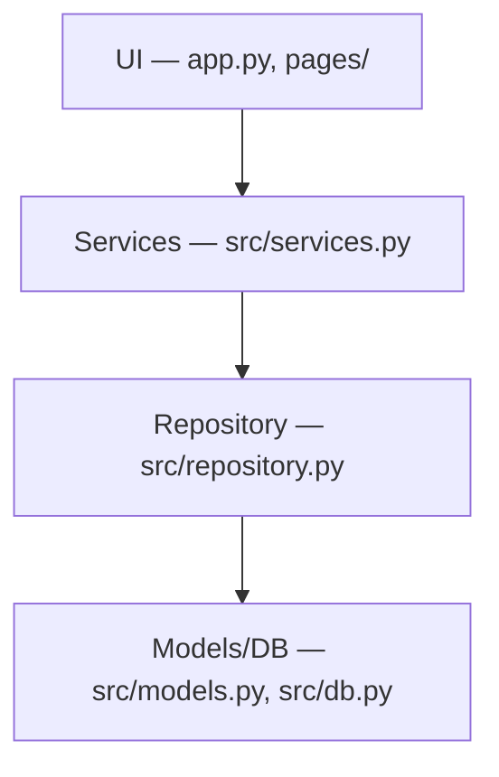

# Architecture

CRM Lite is organized into four layers. Each layer only calls downward.

- **UI** (`app.py`, `pages/`) — Streamlit pages. Renders forms and tables,
  calls into Services for anything that mutates data, and Repository
  directly for read-only listing.
- **Services** (`src/services.py`) — validation and business rules
  (required fields, email format, allowed interaction types, referential
  checks). Raises `ValueError` on invalid input; the UI layer catches
  this and shows it as an error.
- **Repository** (`src/repository.py`) — CRUD data access via SQLAlchemy
  `Session`. No validation logic; assumes valid input.
- **Models/DB** (`src/models.py`, `src/db.py`) — SQLAlchemy ORM entity
  definitions and the SQLite engine/session factory.