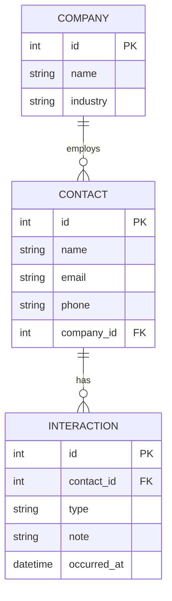

A Company has zero or more Contacts; a Contact optionally belongs to one
Company. A Contact has zero or more Interactions; deleting a Contact
cascades to delete its Interactions (see `src/models.py`).